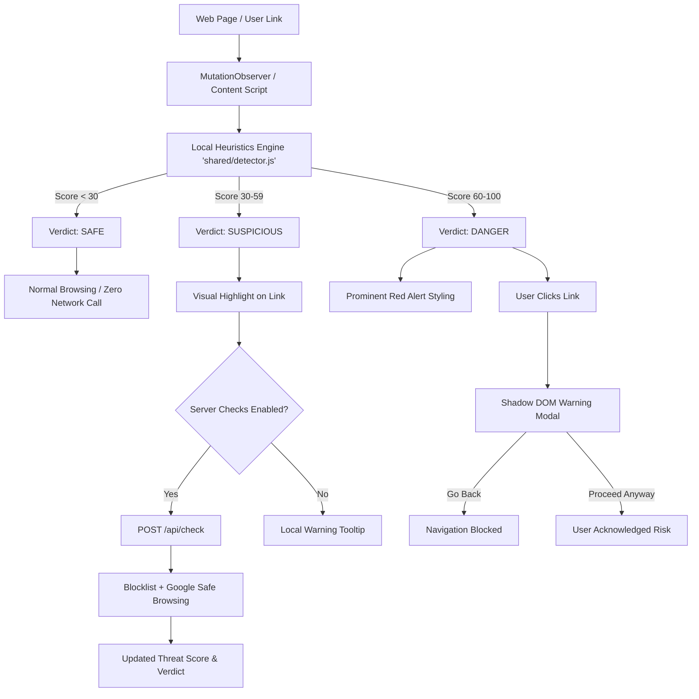

# 🛡️ PhishGuard — Intelligent Phishing Link Detection & Protection

[](LICENSE)


> **Proactive anti-phishing protection before you click.**  
> PhishGuard flags fraudulent, deceptive, and typosquatted links directly in your browser using an open, explainable, rule-based heuristics engine, backed by optional threat intelligence feeds.

---

## 🌟 Overview

Modern phishing attacks exploit look-alike domains, URL shorteners, punycode homographs, and credential-harvesting parameters that evade traditional email filters. **PhishGuard** protects users in real time with a dual-layer defense:

1. **Client-Side First Defense**: An ultra-fast, local heuristics engine analyzes links inside your browser before you ever click them — with **zero network latency** and **100% privacy** for legitimate browsing.
2. **Server-Side Threat Intelligence**: A lightweight Express API validates suspicious links against curated blocklists and Google Safe Browsing feeds with built-in caching and rate limiting.

PhishGuard includes a **Manifest V3 cross-browser extension**, an **interactive web checker**, and a **RESTful inspection API**.

---

## 🚀 Key Features

- **⚡ Instant On-Device Scanning**: High-speed detection runs in real-time as DOM elements render using an optimized `MutationObserver`.
- **🔒 Privacy-Preserving Architecture**: Safe links **never leave your machine**. Only links flagged as suspicious are ever transmitted to the server for secondary confirmation (and can be completely disabled in settings).
- **🛑 Proactive Navigation Guard**: Intercepts clicks on high-risk (`danger`) links, presenting an isolated Shadow DOM warning modal that details specific threats before opening the target URL.
- **🧠 100% Explainable Scoring**: Every evaluated link receives a normalized threat score (`0 - 100`) accompanied by an explicit breakdown of triggering heuristics (e.g., brand impersonation, punycode, raw IP host).
- **🎯 Brand Protection & Typosquatting Detection**: Employs Levenshtein distance calculations and character normalization (e.g. `1` → `l`, `0` → `o`) across top-targeted brands (PayPal, Google, Apple, Microsoft, Chase, Binance, etc.).
- **🔄 Shared UMD Core Engine**: Single, synchronized detector codebase (`shared/detector.js`) powering the browser extension, web application, and backend API seamlessly.

---

## 🏗️ Architecture & Flow



---

## 📊 Heuristics Matrix & Scoring

PhishGuard calculates threat severity using weighted heuristics tailored against modern attack vectors:

| Heuristic Trigger | Penalty | Example Threat Vector |
| :--- | :---: | :--- |
| **Known-Phishing Blocklist** | `+100` | Matched in local blocklist database |
| **Google Safe Browsing** | `+100` | Flagged by threat intelligence API |
| **Brand Impersonation** | `+40` | `paypal.secure-login-update.xyz` |
| **Raw IPv4 Address Host** | `+35` | `http://192.168.1.100/verify` |
| **Typosquatting (Levenshtein)** | `+35` | `paypa1.com`, `g00gle.com` |
| **Credential / `@` Smuggling** | `+30` | `https://google.com@malicious-site.top` |
| **Punycode / Homograph** | `+30` | `https://xn--pple-43d.com` |
| **Sensitive Keyword Clustered** | `+5 to +20` | `.../login/verify/wallet/banking` |
| **High-Risk Suspicious TLD** | `+15` | `.zip`, `.mov`, `.xyz`, `.top`, `.click`, `.icu` |
| **Unencrypted HTTP Protocol** | `+10` | Non-SSL link handling sensitive actions |
| **Excessive Subdomains (>4)** | `+10` | `auth.login.verify.update.domain.com` |
| **Multiple Hyphens in Host** | `+10` | `secure-login-update-account.com` |
| **URL Shortener Redirection** | `+10` | `bit.ly`, `tinyurl.com`, `t.co`, `cutt.ly` |
| **Open-Redirect Parameter** | `+10` | `?redirect=https://evil.com` |
| **Non-Standard Port** | `+10` | `https://example.com:8443` |
| **Excessive URL Length (>100)**| `+5 to +10` | 200+ character obfuscated links |

### Scoring & Verdicts
- 🟢 **Safe (`0 - 29`)**: Normal behavior; no warnings displayed.
- 🟡 **Suspicious (`30 - 59`)**: Outlined in yellow dashes (`outline: 2px dashed #d97706`); tooltips reveal triggered warning flags.
- 🔴 **Danger (`60 - 100`)**: Highlighted in red (`outline: 2px solid #dc2626`); clicks are intercepted with a confirmation prompt.

---

## 🗂️ Project Structure

```text
phishguard/
├── shared/
│   └── detector.js            # Universal rule engine (UMD module)
├── extension/                 # Manifest V3 browser extension
│   ├── manifest.json          # Chrome/Firefox extension manifest
│   ├── detector.js            # Synced copy of engine
│   ├── content.js             # In-page link scanner & click interceptor
│   ├── content.css            # Visual warning highlights
│   ├── popup.html / popup.js  # Instant manual checker popup
│   ├── options.html / .js     # User preferences & API settings
│   └── icons/                 # Extension icons (16, 48, 128)
├── backend/                   # Express inspection API & Web UI
│   ├── server.js              # Express API with rate limiting & caching
│   ├── package.json           # Backend dependencies and test scripts
│   ├── data/
│   │   ├── blocklist.txt      # Curated domain blocklist
│   │   └── reports.jsonl      # User-reported phishing logs
│   ├── public/                # Standalone Web Checker interface
│   │   ├── index.html         # Responsive web UI
│   │   ├── style.css          # Clean styling
│   │   └── app.js             # Web UI interaction logic
│   └── test/
│       └── detector.test.js   # Automated unit tests using node:test
├── Dockerfile                 # Production-grade multi-stage container
├── docker-compose.yml         # Container orchestration
├── render.yaml                # One-click deployment specification
└── sync-detector.sh           # Synchronization script for shared core
```

---

## 🚦 Getting Started

### Prerequisites
- **Node.js**: v18.0.0 or higher
- **npm**: v9.0.0 or higher
- *(Optional)* **Docker & Docker Compose**

### 1. Run the Backend API & Web Checker Locally

```bash
# Navigate to backend directory
cd backend

# Install dependencies
npm install

# Start in development watch mode
npm run dev

# Or start in standard production mode
npm start
```

Visit the interactive Web Checker in your browser:
👉 **[http://localhost:3000](http://localhost:3000)**

### 2. Run with Docker

```bash
# Build and run container in detached mode
docker compose up -d --build

# Inspect logs
docker compose logs -f api
```

### 3. Load the Extension into Your Browser

#### Chrome / Brave / Microsoft Edge:
1. Open `chrome://extensions` (or `edge://extensions` / `brave://extensions`).
2. Toggle **Developer mode** on (top-right corner).
3. Click **Load unpacked**.
4. Select the `extension/` folder inside this repository.
5. Pin **PhishGuard** to your toolbar!

#### Firefox:
1. Open `about:debugging#/runtime/this-firefox`.
2. Click **Load Temporary Add-on…**.
3. Select `extension/manifest.json`.

---

## 🧪 Testing

Run the built-in automated test suite to verify detection accuracy across common attack vectors:

```bash
cd backend
npm test
```

The test suite tests:
- Safe verification on official domains (`google.com`, `apple.com`, etc.)
- Raw IP + unencrypted HTTP credential routes
- Brand impersonation and subdomain spoofing
- Typosquatting and character substitutions
- Embedded authentication (`@` trick)
- Blocklist overrides and edge-case protocols

---

## 🔌 API Reference

### `GET /api/health`
Health check endpoint reporting API status, blocklist size, and threat intelligence readiness.

**Response:**
```json
{
  "ok": true,
  "blocklist": 14,
  "safeBrowsing": false
}
```

---

### `POST /api/check`
Batch analyzes up to 25 URLs per request with TTL caching and rate limiting.

**Request:**
```bash
curl -X POST http://localhost:3000/api/check \
  -H "Content-Type: application/json" \
  -d '{"urls": ["https://paypal.secure-login-update.xyz/signin", "https://google.com"]}'
```

**Response:**
```json
{
  "results": [
    {
      "url": "https://paypal.secure-login-update.xyz/signin",
      "host": "paypal.secure-login-update.xyz",
      "score": 75,
      "verdict": "danger",
      "reasons": [
        { "points": 15, "reason": "Uncommon TLD “.xyz” often abused by phishing" },
        { "points": 10, "reason": "Many hyphens in domain name" },
        { "points": 10, "reason": "Sensitive keywords: signin, login" },
        { "points": 40, "reason": "Impersonates “paypal” but is not an official paypal domain" }
      ]
    },
    {
      "url": "https://google.com",
      "host": "google.com",
      "score": 0,
      "verdict": "safe",
      "reasons": []
    }
  ]
}
```

---

### `POST /api/report`
Submits community phishing reports for review.

**Request:**
```bash
curl -X POST http://localhost:3000/api/report \
  -H "Content-Type: application/json" \
  -d '{"url": "https://suspicious-target.top", "note": "Targeted fake invoice email"}'
```

---

## ⚙️ Configuration & Environment Variables

| Variable | Default | Description |
| :--- | :---: | :--- |
| `PORT` | `3000` | Port for the Express server to bind to |
| `DATA_DIR` | `./data` | Directory where `reports.jsonl` and `blocklist.txt` reside |
| `SAFE_BROWSING_KEY`| *empty* | Optional Google Safe Browsing API v4 key |

> [!TIP]
> To enable Google Safe Browsing lookup, obtain an API key from Google Cloud Console and start the server with:
> ```bash
> SAFE_BROWSING_KEY="your-api-key" npm start
> ```

---

## 🚢 Production Deployment

### Deploy to Render
The repository includes a ready-to-use `render.yaml` specification:
1. Fork or push this repository to GitHub.
2. In [Render](https://render.com), choose **New** → **Blueprint**.
3. Connect your repository — Render will configure the Docker web service automatically.
4. Set the **API URL** in the extension settings (`options.html`) to your deployed Render URL.

### Publish Extension to Stores
- **Chrome Web Store**: Package the extension directory:
  ```bash
  cd extension && zip -r ../phishguard-extension.zip .
  ```
  Upload `phishguard-extension.zip` in the [Chrome Web Store Developer Dashboard](https://chrome.google.com/webstore/devconsole).
- **Firefox Add-ons**: Upload the zip directly at [addons.mozilla.org](https://addons.mozilla.org).

---

## 🤝 Contributing

We welcome contributions to strengthen detection rules, add high-risk brands, and expand test cases:

1. **Fork** the repository & create your feature branch: `git checkout -b feature/new-heuristic`.
2. **Modify rules** in `shared/detector.js`.
3. **Synchronize** changes to the extension:
   ```bash
   ./sync-detector.sh
   ```
4. **Add unit tests** in `backend/test/detector.test.js`.
5. Run the test suite: `cd backend && npm test`.
6. Submit a **Pull Request**.

---

## 📄 License

Distributed under the **MIT License**. See [`LICENSE`](LICENSE) for complete terms.

